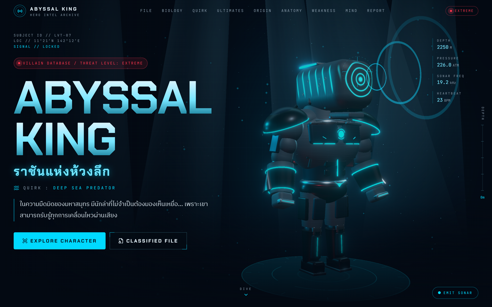

# ABYSSAL KING — The Deep Sea Predator

An interactive 3D villain presentation website. **ABYSSAL KING** (ราชันแห่งห้วงลึก) is an original, fan-made villain character inspired by the world and character-design philosophy of *My Hero Academia*, and his design draws on the biology of the sperm whale. The site is styled as a classified hero-intelligence archive, with a procedurally built 3D character, cinematic scroll animations, and Thai-language content.

[](https://shibaan.github.io/abyssal-king/)

### 🌊 [Live Demo → shibaan.github.io/abyssal-king](https://shibaan.github.io/abyssal-king/)

[](https://github.com/shibaan/abyssal-king/actions/workflows/deploy.yml)

---

## Features

- **Interactive 3D Character**: a fully procedural humanoid sperm-whale villain built with Three.js geometry, with no external model files. It has animated sonar shaders, slow rotation, a floating idle motion, mouse parallax, head tracking, and a hover glow. Click the model or use **EMIT SONAR** to fire a sonar pulse.
- **Anatomy Hotspots**: eight hotspots on a draggable 3D model. Selecting a feature rotates the model to face it, and hotspots on the far side hide automatically.
- **10 Sections**: Intro, Classified File, Biology, Quirk System, Ultimate Moves, Origin Story, Character Design, Weakness Analysis, Personality & Philosophy, and Threat Report.
- **Animation**
  - Scroll-driven sequences built with GSAP ScrollTrigger: the *Black Abyss* ultimate (charge, release, screen shake) and the word-by-word quote reveal.
  - Framer Motion reveals, page transitions, and a loading screen.
  - Canvas energy effects and animated SVG diagrams.
- **Interactive UI**: ability cards that open detail views (keyboard: ← → Esc), an auto-cycling ultimate-move selector, tilt cards, a custom cursor on desktop, and a depth gauge that tracks scroll progress.
- **Responsive Design**: layouts for desktop, tablet, and mobile, with a mobile navigation menu and touch-friendly controls.
- **Accessibility & Performance**
  - Respects `prefers-reduced-motion`.
  - 3D scenes are lazy-loaded and pause rendering when off-screen.
  - Bloom post-processing is disabled on mobile.
  - An SVG fallback replaces the 3D character when WebGL is unavailable.
  - Thai-aware word segmentation (`Intl.Segmenter`) keeps animated text from splitting vowel and tone marks.

> Real sperm-whale biology is presented separately from the character's fictional Quirk abilities.

## Tech Stack

| Area | Technology |
| --- | --- |
| UI framework | [React 19](https://react.dev/) |
| Build tool | [Vite](https://vite.dev/) |
| 3D rendering | [Three.js](https://threejs.org/), [React Three Fiber](https://r3f.docs.pmnd.rs/), [Drei](https://drei.docs.pmnd.rs/), [React Postprocessing](https://react-postprocessing.docs.pmnd.rs/) |
| Animation | [GSAP](https://gsap.com/) (ScrollTrigger), [Framer Motion](https://motion.dev/) |
| Smooth scrolling | [Lenis](https://lenis.darkroom.engineering/) |
| Styling | [Tailwind CSS v4](https://tailwindcss.com/) |
| Icons | [Lucide](https://lucide.dev/) |

## Getting Started

**Requirements:** [Node.js](https://nodejs.org/) 20.19+ or 22.12+ (required by Vite) and npm.

```bash
git clone https://github.com/shibaan/abyssal-king.git
cd abyssal-king
npm install
npm run dev
```

The dev server runs at <http://localhost:5173/>.

## Build & Preview

```bash
npm run build     # production build → dist/
npm run preview   # serve the production build locally
```

The production build uses the base path `/abyssal-king/` so it matches GitHub Pages, so the preview server runs at <http://localhost:4173/abyssal-king/>. The base path is set in [`vite.config.js`](vite.config.js).

## Deployment

The site deploys to **GitHub Pages** through GitHub Actions. Every push to the `main` branch triggers [`.github/workflows/deploy.yml`](.github/workflows/deploy.yml), which runs `npm ci` and `npm run build`, then publishes `dist/` to [shibaan.github.io/abyssal-king](https://shibaan.github.io/abyssal-king/). The workflow can also be run manually from the [Actions tab](https://github.com/shibaan/abyssal-king/actions).

## Browser Requirements

Use a modern browser with **WebGL** support, such as current versions of Chrome, Edge, Firefox, or Safari, on desktop or mobile.

- **Hardware acceleration** should be enabled for smooth 3D rendering.
- Without WebGL, the site still works: an illustrated SVG version of the character replaces the 3D scenes.
- With *reduce motion* turned on in the OS, smooth scrolling and most animations are toned down.

## Project Structure

```
abyssal-king/
├── .github/workflows/deploy.yml   # GitHub Pages build & deploy
├── docs/images/                   # README screenshots (not part of the site build)
├── public/                        # static assets (favicon)
├── src/
│   ├── components/                # shared UI: navbar, loader, cursor, reveal helpers
│   ├── data/content.js            # all site content (Thai text, abilities, hotspots)
│   ├── hooks/                     # device / WebGL detection, navigation context
│   ├── sections/                  # the 10 page sections
│   ├── three/                     # 3D scenes and the procedural character model
│   ├── visuals/                   # SVG / canvas illustrations and diagrams
│   ├── App.jsx                    # layout, smooth scrolling, page transitions
│   ├── index.css                  # Tailwind theme and global styles
│   └── main.jsx                   # entry point
├── index.html
└── vite.config.js
```

## Disclaimer

ABYSSAL KING is an original fan-made character. This project is not affiliated with or endorsed by the creators or rights holders of *My Hero Academia*. It uses no copyrighted character models or artwork, and all 3D geometry and illustrations are generated in code.
